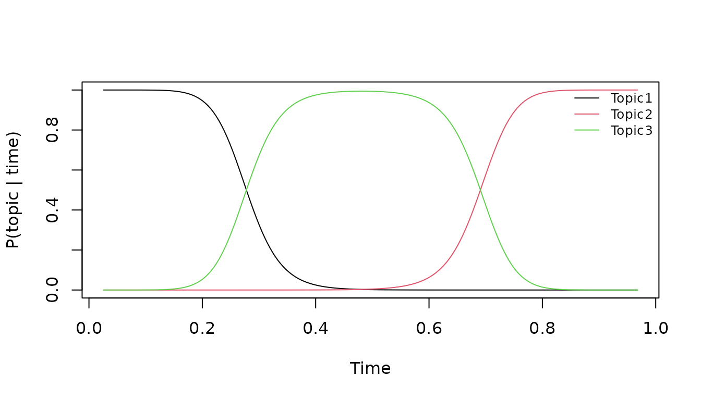
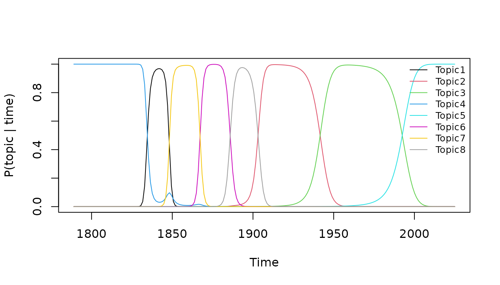

# Getting started with topicsovertime

Topics over Time (TOT; Wang and McCallum, 2006) is a topic model in
which every topic has, besides its distribution over words, a Beta
distribution over continuous time. Topics are therefore found jointly
from word co-occurrence and from *when* documents were written. Time is
neither discretized nor modelled with Markov dynamics, and the meaning
of a topic is constant: what changes over time is how often each topic
occurs.

## A simulated corpus

``` r

library(topicsovertime)
set.seed(1)
sim <- simulate_tot(n_docs = 300, n_topics = 3)
fit <- tot(sim$x, sim$time, k = 3, n_iter = 200)
fit
#> Topics over Time model
#>   topics: 3, documents: 300, vocabulary: 100
#>   iterations: 200, alpha: 16.66667, beta: 0.1, time_weight: 1
#>   time range: 0.02560277 to 0.967983
fit$psi        # Beta parameters on the normalized time scale
#>           shape1    shape2
#> Topic1  2.207427 15.892580
#> Topic2 13.158485  1.811005
#> Topic3  7.915801  8.643318
plot(fit)      # P(topic | time)
```



## U.S. presidential inaugural addresses

The paper analyses State of the Union addresses; the inaugural addresses
shipped with quanteda are a similar corpus spanning more than two
centuries.

``` r

library(quanteda)
#> Package version: 4.5.1
#> Unicode version: 15.1
#> ICU version: 74.2
#> Parallel computing: disabled
#> See https://quanteda.io for tutorials and examples.
toks <- tokens(data_corpus_inaugural, remove_punct = TRUE,
               remove_numbers = TRUE)
toks <- tokens_remove(tokens_tolower(toks), stopwords("en"))
x <- dfm_trim(dfm(toks), min_termfreq = 5)
year <- docvars(data_corpus_inaugural, "Year")

set.seed(2026)
fit <- tot(x, year, k = 8, n_iter = 300)
terms(fit, 8)
#>      Topic1         Topic2       Topic3    Topic4       Topic5   
#> [1,] "government"   "government" "us"      "government" "us"     
#> [2,] "people"       "can"        "world"   "may"        "america"
#> [3,] "states"       "must"       "can"     "people"     "nation" 
#> [4,] "power"        "upon"       "people"  "states"     "must"   
#> [5,] "upon"         "people"     "peace"   "great"      "people" 
#> [6,] "may"          "world"      "new"     "public"     "new"    
#> [7,] "constitution" "great"      "must"    "country"    "world"  
#> [8,] "one"          "nation"     "freedom" "every"      "can"    
#>      Topic6         Topic7         Topic8      
#> [1,] "government"   "shall"        "people"    
#> [2,] "people"       "can"          "upon"      
#> [3,] "country"      "states"       "government"
#> [4,] "upon"         "constitution" "public"    
#> [5,] "states"       "government"   "states"    
#> [6,] "constitution" "upon"         "shall"     
#> [7,] "public"       "may"          "must"      
#> [8,] "great"        "people"       "congress"
plot(fit)
```



[`predict()`](https://rdrr.io/r/stats/predict.html) folds new documents
into a fitted model; `type = "time"` predicts when a document was
written:

``` r

pred <- predict(fit, x, type = "time")
head(data.frame(actual = year, predicted = round(pred)))
#>                 actual predicted
#> 1789-Washington   1789      1857
#> 1793-Washington   1793      1873
#> 1797-Adams        1797      1849
#> 1801-Jefferson    1801      1861
#> 1805-Jefferson    1805      1851
#> 1809-Madison      1809      1859
cor(pred, year)
#> [1] 0.9167397
```

## Balancing words and time

Each token carries the document’s timestamp, so a long document’s time
contributes many times to the likelihood. `time_weight` rescales that
contribution: `1` is the sampler exactly as in the paper, and
`"inverse_length"` counts each timestamp once per document. The paper
notes that results are sensitive to this setting and recommends tuning
it.

## Reference

Wang, X. and McCallum, A. (2006). Topics over time: a non-Markov
continuous-time model of topical trends. *KDD ’06*, 424–433.
<https://doi.org/10.1145/1150402.1150450>
